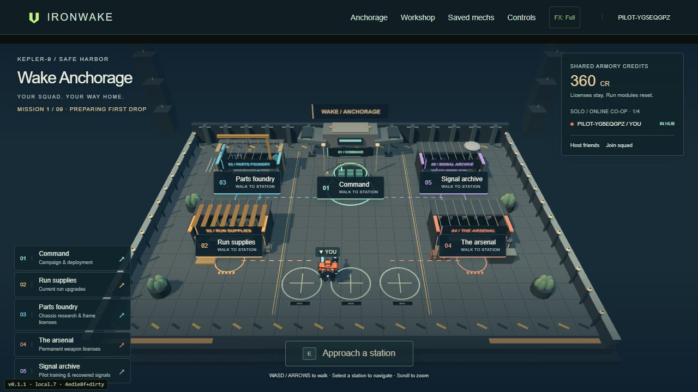
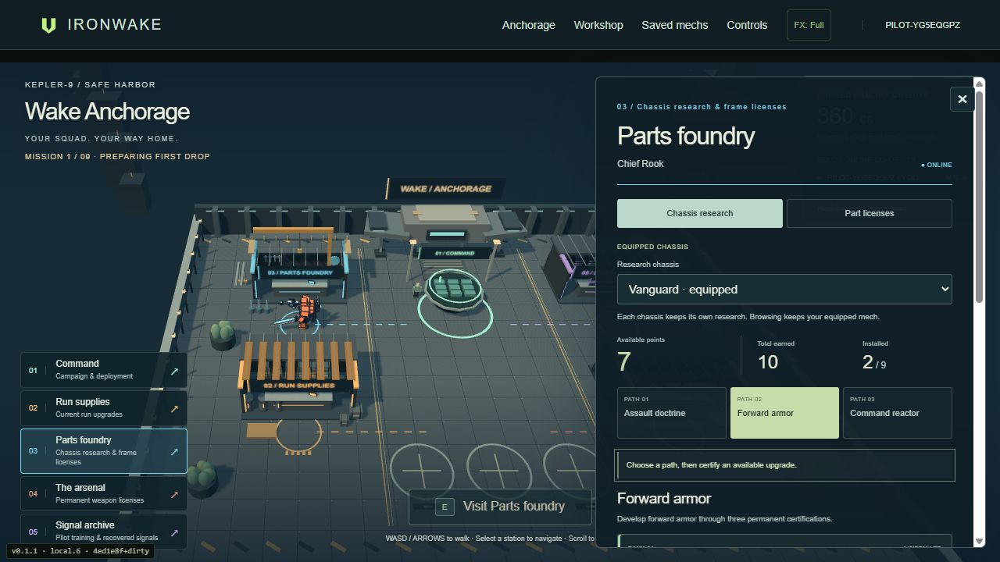
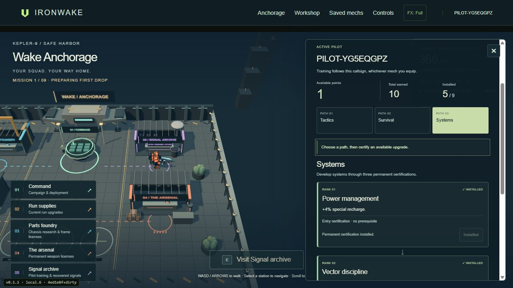
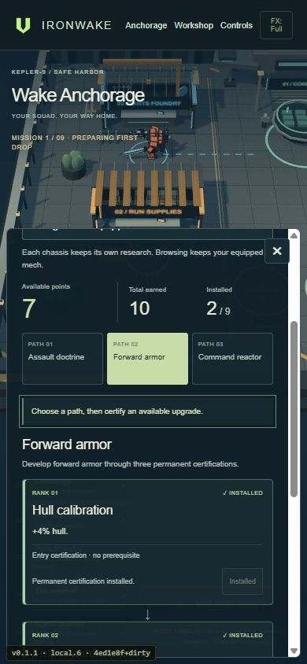
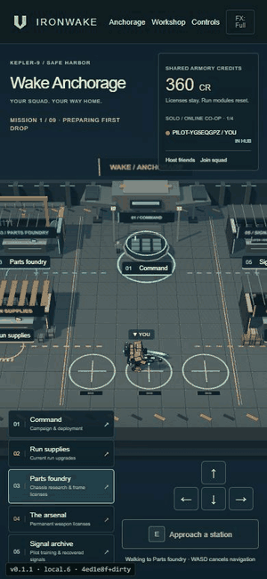

# Career progression at Wake Anchorage

Start or continue a campaign to enter the existing walkable 3D safe harbor. Visit **Chief Rook at Parts foundry** for chassis research and frame fitting, or **Archivist Echo at Signal archive** for pilot training. Walk with WASD/arrows and press E nearby, use the touch controls, or select a physical station marker/directory entry to navigate there. Escape closes the station and returns to walking.

Research and training use contextual station panels with the world and equipped mech still visible. Choose one of three paths to inspect its three chained certifications. The foundry also retains its part licenses; the archive retains its recovered signals. Run supplies continues to own temporary run modules, the arsenal owns hand/special fitting, and Command owns campaign preparation and launch.

## Progression and compatibility

Each of the fifteen chassis has nine upgrades and its own point balance. Legacy custom frames retain their separate tree. Pilot disciplines follow the browser's persistent callsign across mechs, parts and paint. Browsing another chassis's research does not equip it.

Every tree starts with one point. A successful campaign extraction adds one research point to the deployed chassis and one skill point to the local pilot, up to eighteen earned points per tree. Each path costs 1, then 2, then 3 points; the previous node is required. Practice, classic Cinderfall, duels, withdrawal and defeat award no career points. A free respec at the appropriate physical station refunds that tree's spent points.

The existing version-1 `iw-career-v1` save and node IDs are unchanged. Purchases made before the hub revision retain their ranks and balance. New campaigns preserve career progression, armory licenses/credits and existing best times, while clearing campaign run modules. Career progress is personal to this browser, separate from the host's shared `iw-hub-armory` save, campaign refit tokens and combat-time XP/salvage. Account sync and career export are outside this first pass.

## Normal campaign loop

1. **Start/continue → Anchorage.** Load the campaign and personal career, migrate existing equipped/saved gear licenses once, register present pilots and enter the arrival berths.
2. **Stations → preparation.** Physically visit foundry/archive to certify or respec, and vendors to fit owned gear. Purchases refresh deployment ranks and clear the local pilot's readiness. Other squad members can keep moving while a station is open.
3. **Command → mission.** Choose the campaign drop, contract, insertion and loadout. The host must be near Command; all online pilots mark ready. License, payload and mount checks remain enforced. Command's hull display, deployment and combat HUD share the researched combat stats.
4. **Mission → result.** Deployment freezes sanitized career ranks, then applies run effects separately. Extraction settles career receipts before campaign advancement; the host settles campaign refit tokens and shared armory rewards. The host always sends the final world state before returning the squad.
5. **Result → Anchorage → next drop.** Return resets poses to arrival berths and clears readiness. Spend earned points/refit tokens at their stations, then visit Command for the next authored mission.
6. **Save/resume or failed run.** Continue restores the campaign and persistent balances, without replaying rewards. Defeat/withdrawal ends the current run under the existing rules; start a fresh run at Command while keeping career, armory and best times. Practice remains available through the existing workshop/Command controls.

## Existing hub dependency

Canonical main at the revision base `3723ada` does not contain the hub. The actual built foundation is the single local `feature/coop-campaign-hub` commit `1e25f0583902d6b0b5480d922ca9904ea0709d64`, based on `b3dadf2`. This revision ports its four hub modules, station/campaign application glue and hub tests selectively. It does not merge that older branch or roll back newer enemy, destruction or build-label work. The original plaza, vendor positions, NPCs, collisions, navigation, renderer and armory model are reused; camera framing accounts for the open station panel.

The dependency is included in this PR, so the supported campaign path runs directly from this branch. The separate field-progression branch/PR is not included or changed.

## Runtime boundaries

- `career-progression.js` remains the save/catalog/reward model. `career-hub.js` gates mutations by the trusted local pilot, physical station and idle hub state. Stale/invalid/underfunded requests leave the save untouched.
- `career-view.js` and `career.css` render a compact path inside the existing `hub-view.js` vendor panel. There is no global Upgrade trees screen or modal entry point.
- `hub-state.js` retains station movement, collision, shared armory, licenses, extraction receipts and story data. Pose authority, purchases and run refits stay on the host. `hub-scene.js` reuses actual equipped mech models.
- `cleanBuild` and `mechStats(build)` retain hardware semantics. Separate roster `progression: {mech: [], pilot: []}` ranks are sanitized at deployment. No numeric client modifiers, payload changes or extra heavy mounts are accepted.
- `combatStats(player)` and player-aware mission callbacks preserve researched hull through damage, recovery, repair, checkpoints, revives and redeploys. Career bonuses compose with existing run effects before the in-progress field layer is integrated.
- Career never consumes or changes `p.field`, field XP, live offers, items, relays, salvage or refit choices. The field branch still needs reconciliation at overlapping combat/app/stat-callback hooks and combined balance testing.
- Rooms use `ironwake-anchorage-career-cinematic-v3-` (or the isolated demolition prefix), preventing incompatible simulations from joining. Saves remain local and are not authenticated account progression.

## Verification

Run `node --test tests/*.test.js` and the project's Wrangler production dry run. Start `node scripts/preview-server.mjs 4187` and open `http://127.0.0.1:4187/ironwake/`.

Automated lifecycle regressions exercise actual hub walking/mutation gates, two authored objective/extraction simulations, deployment stats, reward deduplication, refits, JSON resume, defeat/new-run retention and transported guest attribution. They use deterministic combat fixtures, rather than claiming an AI combat balance playthrough.

The development-only `/tests/hub-campaign-flow.html` embeds the actual game with a local mocked PeerJS transport and synthetic host outcomes. It exercises the real guest join, station, readiness, deployment, result, reward, return, repeat-mission, defeat and reload handlers, with visible checks. This verifies application transitions; live WAN squad testing and a manually completed full campaign remain playtest gaps. Both it and `/tests/career-fixtures.html` stay outside deployed assets.

## Captured implementation

Final local checks passed **313 Node tests**, the Wrangler **4.151.1** production dry run, syntax checks and Git whitespace checks. Desktop browser checks covered the normal solo start/continue, physical research/training and fitting, researched mission hull, actual combat defeat, return, failed-run resume and fresh campaign with retained progress. The actual guest UI ran repeated mission/result/return cycles, refit spending, readiness invalidation and reload persistence against the local simulated host, at desktop and phone width. The phone check caught and verified the fix for stale readiness after defeat/new campaign.

The [campaign-flow verification record](campaign-flow-verification.txt) records the simulated-host checks. Fixture-assisted earned points are shown in the captures; the visible build label predates the final revision commit.

