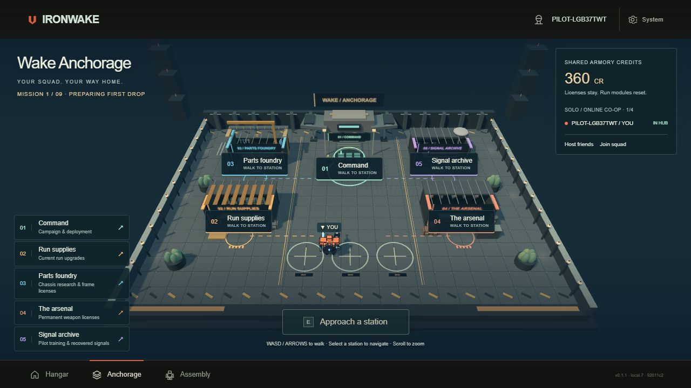
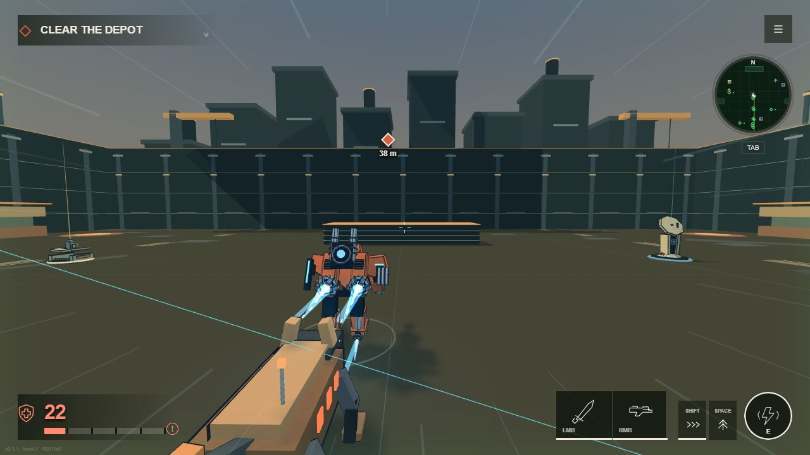
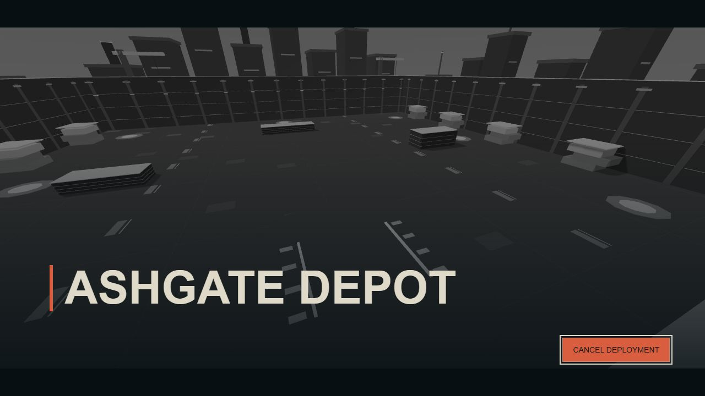
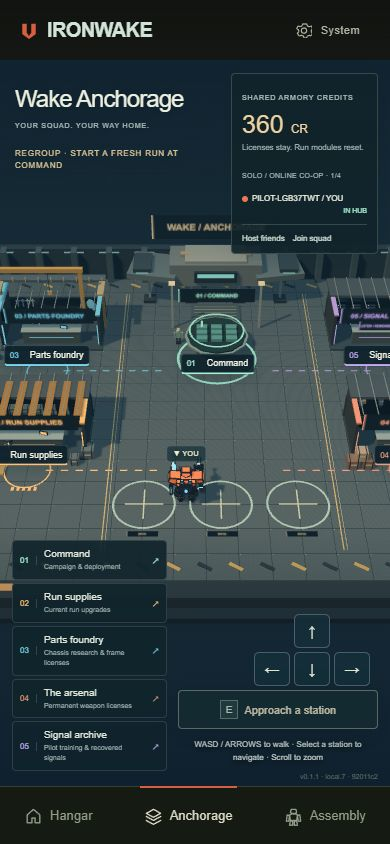
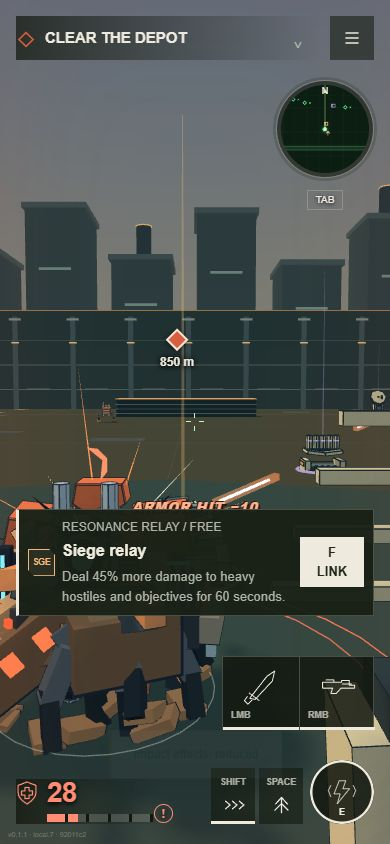
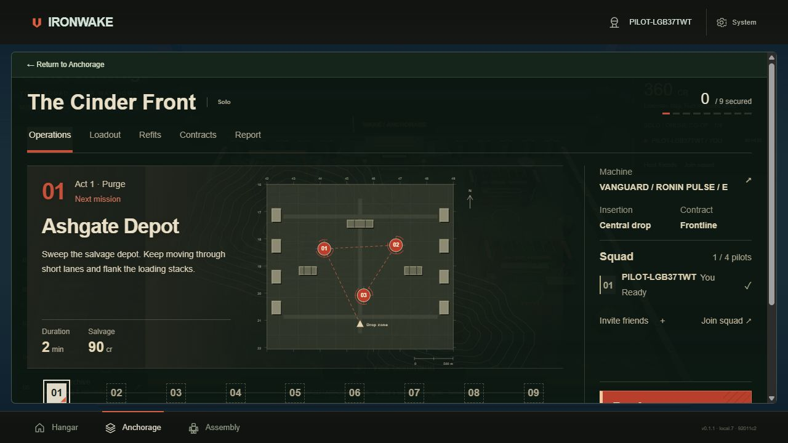

# Visual-pass screenshots

Actual implemented-game captures from runtime **92011c2c81b84da82994f38572a5dc729444ecd2**. These JPEGs are unmodified. Normal UI/gameplay controls were used; no fixtures, staged rewards, simulated victories or DOM changes were used. The browser viewport was restored after portrait capture.

The previous sandboxed localhost listener was unreachable. On the explicit screenshot follow-up, the existing preview server was run outside the execution sandbox, still bound only to 127.0.0.1, and verified to return HTTP 200 before a fresh normal-game tab was opened. No firewall/security settings changed. The previously denied error-page inspection, 4203 field fixture and data:error cleanup were not retried.

## Wake Anchorage at 1280×720: retained physical stations, warm practical pools and machine grounding.

## Ashgate Depot practice at 1280×720, Full effects: live movement, soft ground contact, wall-face cladding, service markings and industrial horizon.

## Normal Ashgate insertion cinematic at 1280×720, showing the implemented arena before combat release.

## Wake Anchorage at 390×844 after return: responsive 3D context and movement controls; viewport emulation, not a physical phone test.

## Ashgate practice at 390×844 after the in-game V toggle confirmed Reduced effects. This is a live combat frame with the contextual field-equipment prompt visible.

## Existing Command/deployment UI at 1280×720, retained by the visual pass.

[Capture metadata and SHA-256 hashes](evidence.json). Console warning/error queries returned no entries during capture. Brief combat captures ended in ordinary defeats; this is not campaign-victory or balance evidence. Portrait uses viewport emulation and ordinary browser input, not a physical touch test. Full campaign, remote-squad, low-end performance and broader visual acceptance remain open.
